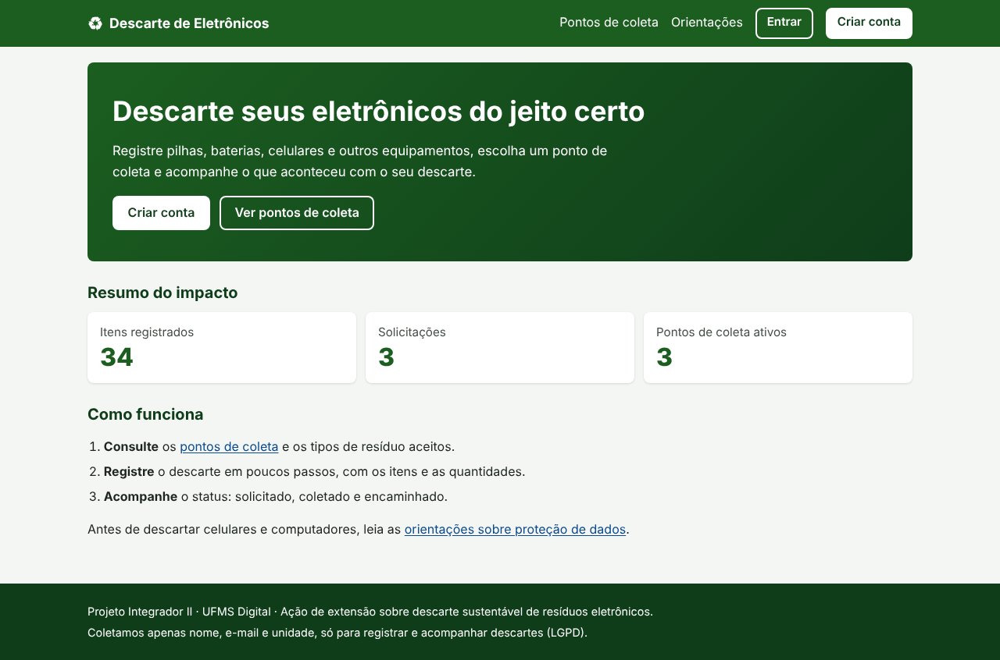
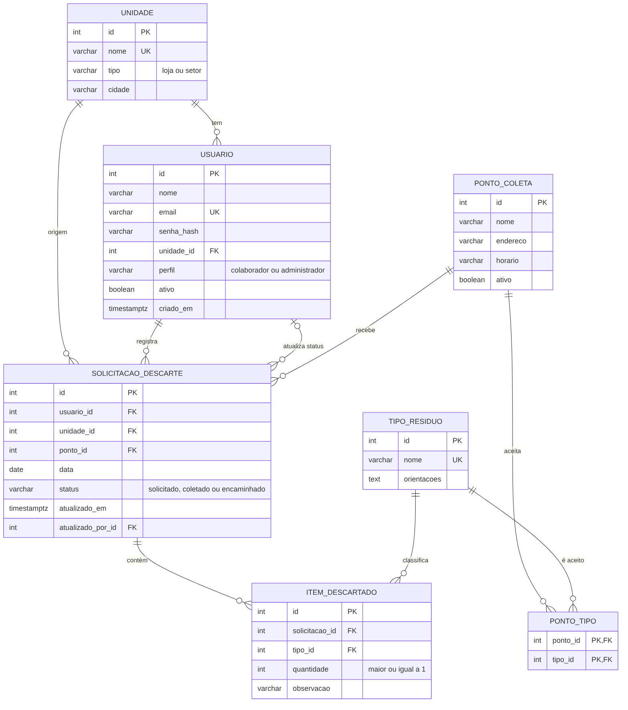

# Descarte de Resíduos Eletrônicos

Aplicação web para **registrar, acompanhar e dar visibilidade ao descarte sustentável de resíduos eletrônicos**
(pilhas, baterias, celulares, carregadores e equipamentos usados) em uma rede de franquias do varejo.

Projeto Integrador de Tecnologia da Informação II – UFMS Digital (extensão: *Descarte sustentável de resíduos
eletrônicos na Multicoisas Franquias*). Funciona em computadores e celulares, direto no navegador.



## Tecnologias

| Camada | Tecnologia |
|---|---|
| Framework web | **Django 5.2 (LTS)**, Python 3.10 ou superior |
| Páginas | HTML5 semântico com *templates* do Django |
| Estilo | CSS3 puro, responsivo (*mobile-first*, Flexbox, Grid, *media queries*) |
| Interatividade | JavaScript puro (sem bibliotecas) como melhoria progressiva |
| Banco de dados | SQLite no desenvolvimento (trocável por PostgreSQL ou MySQL) |
| Controle de versão | Git e GitHub |

## Funcionalidades (requisitos do PI II)

| Requisito | Prioridade | Situação |
|---|---|---|
| RF01 Cadastrar e autenticar usuários, com perfis | Must | Feito |
| RF02 Registrar solicitação de descarte | Must | Feito |
| RF03 Consultar pontos de coleta e tipos aceitos | Must | Feito (consulta pública, sem login) |
| RF04 Acompanhar status (solicitado, coletado, encaminhado) | Must | Feito |
| RF05 Cadastrar e editar pontos de coleta e tipos de resíduo | Must | Feito |
| RF06 Histórico do usuário com filtro por período e tipo | Should | Feito |
| RF07 Relatório com total de itens por tipo, unidade e período | Should | Feito |
| RF08 Orientações sobre descarte correto e proteção de dados | Should | Feito |
| RF09 Exportar relatório em CSV ou PDF | Could | CSV feito; PDF não |
| RF10 Notificações por e-mail ou mensagem | Could | Não feito |
| RF11 Mapa interativo | Won't | Fora desta versão |
| RF12 Integração com sistemas internos | Won't | Fora desta versão |

## Como executar

Pré-requisito: Python 3.10 ou superior e Git.

```bash
# 1. Baixe o projeto
git clone <URL-DO-SEU-REPOSITORIO>
cd residuos-eletronicos

# 2. Crie e ative um ambiente virtual
python -m venv .venv
# Windows (PowerShell):  .venv\Scripts\Activate.ps1
# Windows (cmd):         .venv\Scripts\activate.bat
# Linux ou macOS:        source .venv/bin/activate

# 3. Instale as dependências
pip install -r requirements.txt

# 4. Crie o banco de dados
python manage.py migrate

# 5. (Opcional) Carregue dados de demonstração
python manage.py seed_demo

# 6. Inicie o servidor
python manage.py runserver
```

Abra http://127.0.0.1:8000/ no navegador.

### Contas de demonstração (só no ambiente local)

Criadas pelo comando `seed_demo`:

| Perfil | E-mail | Senha |
|---|---|---|
| Administrador | admin@exemplo.com | demo12345 |
| Colaborador | colaborador@exemplo.com | demo12345 |

Para criar um administrador real (sem os dados de demonstração):

```bash
python manage.py createsuperuser
```

Os pontos de coleta reais e os tipos de resíduo são cadastrados pelo administrador no menu **Gestão**. Os pontos
criados por `seed_demo` são fictícios.

## Testes

```bash
python manage.py test
```

Os 25 testes cobrem cadastro e login, perfis e permissões, registro de descarte (com as regras de validação), fluxo
de status, filtros, relatório e exportação CSV.

## Banco de dados (SQL)

Além das tabelas que o Django cria sozinho (SQLite), o projeto traz o esquema do banco escrito em SQL para
PostgreSQL: tabelas, chaves, restrições, gatilhos, visões e consultas. Veja `database/README.md` para executar
e `docs/BANCO_DE_DADOS.md` para o modelo, o dicionário de dados e os resultados (20 de 20 testes de integridade).



## Controle de versão

O trabalho usa branches por assunto, merges com `--no-ff`, mensagens no padrão *Conventional Commits* e tags de
versão. Detalhes em `docs/GIT.md`.

## Estrutura do projeto

```
residuos-eletronicos/
├── manage.py
├── requirements.txt
├── config/                 # configurações do projeto Django (settings, urls)
├── descarte/               # aplicação principal
│   ├── models.py           # entidades do DER
│   ├── forms.py            # formulários e validações
│   ├── views.py            # regras de cada página
│   ├── urls.py             # rotas
│   ├── permissions.py      # controle de acesso por perfil
│   ├── tests.py            # testes automatizados
│   ├── management/commands/seed_demo.py
│   ├── templates/          # páginas HTML
│   └── static/descarte/    # css/ e js/
├── database/               # scripts SQL (PostgreSQL): esquema, dados, consultas, testes
└── docs/
    ├── DECISOES.md         # principais decisões de desenvolvimento
    ├── BANCO_DE_DADOS.md   # modelo, dicionário de dados e resultados dos scripts SQL
    ├── GIT.md              # estratégia de versionamento
    ├── diagramas/          # DER e diagramas UML
    ├── capturas/           # capturas de tela (celular, tablet e computador)
    └── testes/             # auditoria no navegador e saída da execução dos scripts SQL
```

## Variáveis de ambiente (produção)

| Variável | Uso |
|---|---|
| `DJANGO_SECRET_KEY` | Chave secreta (obrigatória em produção) |
| `DJANGO_DEBUG` | `0` para desligar o modo de depuração |
| `DJANGO_ALLOWED_HOSTS` | Domínios permitidos, separados por vírgula |

## Publicar no GitHub

```bash
git init
git add .
git commit -m "Aplicação web de descarte de resíduos eletrônicos (PI II, módulo 2)"
git branch -M main
git remote add origin https://github.com/<seu-usuario>/<nome-do-repositorio>.git
git push -u origin main
```

## Documentação

- [Decisões de desenvolvimento](docs/DECISOES.md)
- Diagramas: [DER](docs/diagramas/der.png), [casos de uso](docs/diagramas/caso_uso.png),
  [classes](docs/diagramas/classes.png), [sequência](docs/diagramas/sequencia.png)
