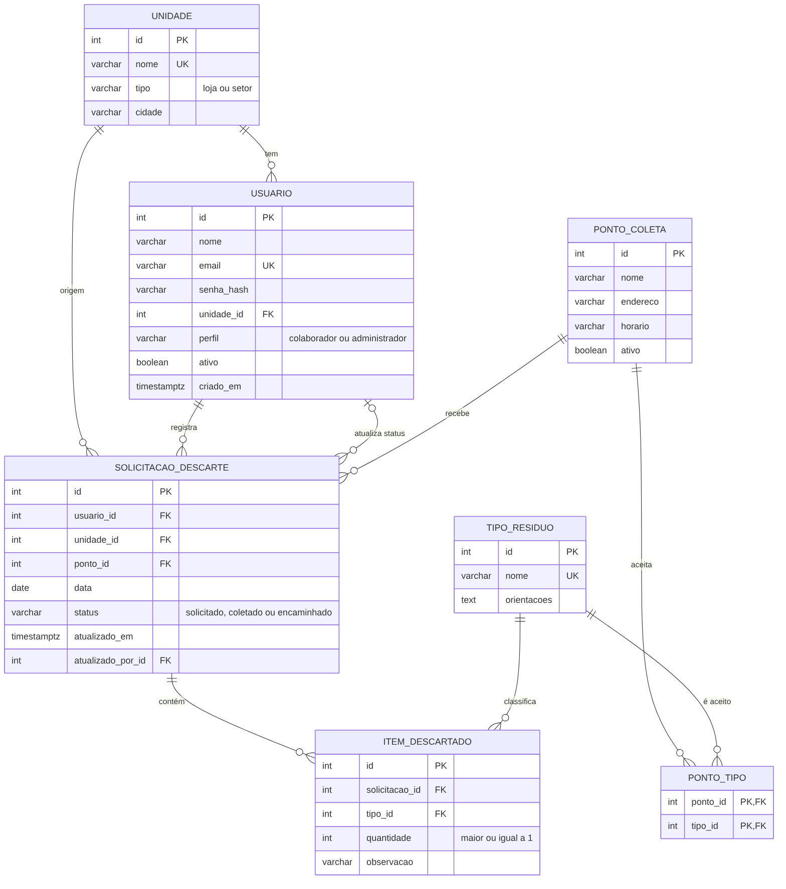

# Banco de dados – modelagem e manipulação

Documento do Módulo 3 do PI II. Complementa `database/` (scripts) e `docs/DECISOES.md`.

## 1. Modelo de dados

Sete tabelas: `unidade`, `usuario`, `tipo_residuo`, `ponto_coleta`, `ponto_tipo` (associativa N:N),
`solicitacao_descarte` e `item_descartado`. Relacionamentos:

| Relacionamento | Cardinalidade | Ação ao apagar o pai |
|---|---|---|
| unidade → usuário | 1:N (usuário pode ficar sem unidade) | SET NULL |
| unidade → solicitação | 1:N | RESTRICT |
| usuário → solicitação (quem registra) | 1:N | RESTRICT |
| usuário → solicitação (quem atualiza o status) | 1:N, opcional | SET NULL |
| ponto de coleta → solicitação | 1:N | RESTRICT |
| solicitação → item | 1:N | CASCADE |
| tipo de resíduo → item | 1:N | RESTRICT |
| ponto de coleta ⇄ tipo de resíduo | N:N, via `ponto_tipo` | CASCADE nos dois lados |

## 2. Dicionário de dados (resumo)

| Tabela | Colunas principais | Restrições |
|---|---|---|
| unidade | id (PK), nome, tipo, cidade | nome único; tipo ∈ {loja, setor} |
| usuario | id (PK), nome, email, senha_hash, unidade_id (FK), perfil, ativo, criado_em | e-mail único, minúsculo e em formato válido; perfil ∈ {colaborador, administrador} |
| tipo_residuo | id (PK), nome, orientacoes | nome único |
| ponto_coleta | id (PK), nome, endereco, horario, ativo | (nome, endereço) único |
| ponto_tipo | ponto_id, tipo_id (PK composta, ambas FK) | não repete a mesma ligação |
| solicitacao_descarte | id (PK), usuario_id, unidade_id, ponto_id, data, status, atualizado_em, atualizado_por_id | data ≤ hoje; status ∈ {solicitado, coletado, encaminhado} |
| item_descartado | id (PK), solicitacao_id, tipo_id, quantidade, observacao | quantidade ≥ 1 |

## 3. Normalização

- **1FN:** todos os campos são atômicos; os itens de uma solicitação ficam em linhas de `item_descartado`, e não em
  uma lista dentro da solicitação.
- **2FN:** a única chave composta é a de `ponto_tipo`, que não tem outras colunas; nenhuma coluna depende de parte da chave.
- **3FN:** os dados do tipo (nome, orientações), do ponto e da unidade ficam nas suas tabelas e as demais só
  guardam a chave; não há dependência entre colunas que não sejam chave.
- **Redundância proposital:** `solicitacao_descarte.unidade_id` repete a unidade do usuário para guardar
  em qual unidade a pessoa estava **na data do pedido**, mesmo que ela troque de unidade depois.

## 4. Regras garantidas pelo próprio banco

| Regra | Mecanismo |
|---|---|
| Valores válidos (tipo, perfil, status, quantidade, e-mail) | CHECK |
| Sem duplicidades (e-mail, nome da unidade, nome do tipo, ligação ponto–tipo) | UNIQUE / PK composta |
| Sem referência a registros inexistentes | FOREIGN KEY |
| Data da solicitação não pode ser futura | CHECK com `CURRENT_DATE` |
| A solicitação nasce `solicitado` e só avança solicitado → coletado → encaminhado | gatilho `tg_solic_fluxo_status` |
| O ponto só recebe os tipos cadastrados para ele (sem tipos cadastrados, aceita todos) | gatilho `tg_item_tipo_do_ponto` |
| Momento da última alteração | gatilho `tg_solic_atualizado_em` |

## 5. Diferenças entre os scripts SQL e as tabelas do Django

Conferido com `python manage.py sqlmigrate descarte 0001`:

- O Django usa os nomes `descarte_*` e acrescenta colunas de autenticação (`is_staff`, `is_superuser`, `last_login`,
  grupos e permissões) que os scripts não têm.
- Na tabela N:N do Django há uma chave artificial `id`; nos scripts, a chave é composta (`ponto_id`, `tipo_id`).
- No Django, o banco só exige `quantidade >= 0`; a regra "pelo menos 1" fica na aplicação (formulário). Nos scripts,
  o banco exige `>= 1`.
- As regras de fluxo de status e de tipo aceito pelo ponto ficam na aplicação (Django); nos scripts, também no banco.
- O sistema web roda em SQLite; os scripts foram escritos e testados em PostgreSQL 16. Migrar o sistema web para
  PostgreSQL exige só trocar `DATABASES` em `config/settings.py` (ainda não foi feito).

## 6. Resultados da execução (PostgreSQL 16)

Todos os resultados completos estão em `testes/saida_execucao_sql.txt`.

- `01` e `02` executaram sem erro (ON_ERROR_STOP ligado): 7 tabelas, 3 unidades, 5 tipos, 3 pontos, 2 usuários,
  3 solicitações e 5 itens.
- `03`: 10 consultas executadas; por exemplo, pilhas somam 20 dos 34 itens (58,8%).
- `04`: atualizações, remoções, ROLLBACK, CASCADE e SET NULL conferidos por contagens (ex.: 0 itens órfãos).
- `05`: **20 de 20** tentativas inválidas rejeitadas com o tipo de erro esperado.

**Falha encontrada na primeira execução:** o teste nº 13 ("pular etapa") apareceu como FALHOU, mas o defeito era do
próprio teste: ele procurava uma solicitação `solicitado`, e o script `04` já tinha avançado a última, então nenhuma
linha foi alterada e nenhum erro ocorreu. O teste passou a criar a solicitação dentro do próprio bloco e, na
segunda execução, aprovou. O gatilho não foi modificado.

## 7. Limitações

- Os scripts rodam só em PostgreSQL (usam gatilhos PL/pgSQL, `GENERATED ... AS IDENTITY` e `string_agg`); não foram
  testados em MySQL.
- Não há backup, ambiente de homologação nem teste de desempenho com grande volume de dados.
- As consultas foram executadas só com os dados de demonstração (34 itens).
- A integração do sistema web com os scripts (usar o PostgreSQL no Django) fica como evolução.
